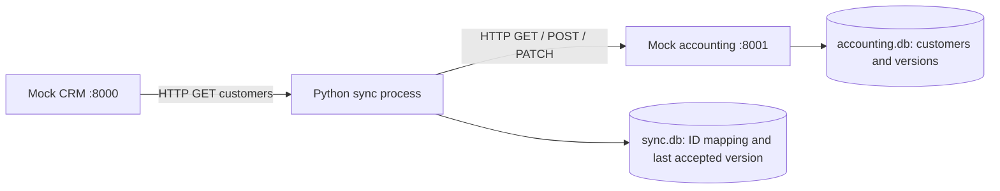

# CRM to accounting customer sync

A small, local glue service that copies customer billing details from a mock CRM to a mock accounting system. It supports creation, updates, duplicate prevention, conflict detection, bounded retries, and continuing after an individual customer fails.

## Assumed customer and value

A small equipment rental company keeps customer details in a CRM and creates invoices in a separate accounting product. Staff currently copy billing names and email addresses manually. Missed updates cause invoices to go to outdated addresses, and repeated entry creates duplicate customers.

This prototype automates that transfer while preserving independent accounting edits for human review. Its intended value is less manual entry, fewer duplicate records, and fewer incorrect billing details. These are expected benefits, not measured business outcomes.

Both products are simulated APIs; this project does not integrate with a real CRM or accounting vendor. The mock systems make the demo repeatable without accounts, credentials, or paid services.

## Requirements and installation

Tested with Python 3.14.8. Use Python 3.14 for this walkthrough. SQLite is included with Python.

Clone this repository, open a terminal in its root directory, and run:

```bash
python3.14 -m venv .venv
source .venv/bin/activate
python -m pip install -r requirements.txt
```

These activation instructions are for macOS/Linux. On Windows, use `.venv\Scripts\Activate.ps1` in PowerShell, with an installed Python 3.14 interpreter.

The direct dependencies are pinned. Their transitive dependencies are not locked, so this is not a fully reproducible dependency lockfile.

## Run locally

Run commands from the repository root. Open three terminal tabs, activating the environment in each with `source .venv/bin/activate`.

Terminal 1: start the CRM.

```bash
fastapi run main.py --host 127.0.0.1 --port 8000
```

Terminal 2: start accounting.

```bash
fastapi run accounting.py --host 127.0.0.1 --port 8001
```

Terminal 3: perform one synchronization pass.

```bash
python sync.py
```

Interactive API pages:

- CRM: <http://127.0.0.1:8000/docs>
- Accounting: <http://127.0.0.1:8001/docs>

The first sync creates two accounting customers. Repeating it reports `Already exists` and creates no duplicates. Both API servers must stay running; the sync script exits after each pass. Press Control+C in a server's terminal to stop it.

For development, `fastapi dev` can replace `fastapi run`. Its automatic reload resets in-memory CRM edits and failure settings whenever the server reloads.

## Architecture



| File | Responsibility |
| --- | --- |
| `main.py` | Mock CRM, two seed customers, and billing email editing |
| `accounting.py` | Persistent mock accounting API, version checks, and failure injection |
| `sync.py` | Field translation, reconciliation, retries, and per-customer results |
| `sync_state.py` | Persistent CRM-to-accounting mapping and accepted accounting version |
| `tests/` | Automated API and sync behavior tests |

The APIs use different field names: CRM `company_name` maps to accounting `display_name`, and `billing_email` maps to `invoice_email`. Stable CRM IDs identify customers; names and email addresses are not identifiers.

Both SQLite files are created next to the Python files and are excluded from Git. No database installation is needed. The accounting API upgrades the earlier demo schema automatically by adding its version column if needed.

## Reconciliation and reliability

1. Fetch the CRM customer list once.
2. With no saved mapping, send an accounting create request carrying the CRM ID. A unique database constraint prevents duplicate CRM IDs. Identical repeats return the existing customer; different details return HTTP 409.
3. With a mapping, read the accounting customer. If its fields already match the desired CRM values, accept its current version and report `Already exists`.
4. If the fields differ but accounting still has the last accepted version, send an update with that expected version.
5. If accounting has a different version and different values, report a conflict and preserve the accounting record.
6. Save the accounting ID and version after a successful result. Continue to the next customer after an HTTP or conflict failure.

The accounting update checks the expected version and writes atomically. If a stale request's desired fields already match the saved record, it returns the record successfully. This supports retrying an update whose response was lost after it committed. A stale request cannot overwrite a different newer value.

The remote write and local sync-state save are separate transactions. Recovery relies on the accounting API's stable CRM reference, version checks, and matching-value handling. This is not a distributed transaction or a general exactly-once delivery guarantee. A real vendor would need compatible API behavior or a different recovery strategy.

Accounting requests retry network errors and HTTP 500, 502, 503, and 504, with at most three attempts. Waits are 0.5 and 1 second. Conflicts and other HTTP errors are not retried. Requests use a five-second HTTPX timeout configuration; this is not a five-second deadline for the whole run. The initial CRM list request is not retried.

## Demonstrate the behavior

Use the API documentation's **Try it out** and **Execute** buttons. Start from a successful sync before each scenario.

### Create and repeat

Run `python sync.py` twice. There should still be only two accounting customers with the same IDs.

### CRM update

In the CRM, call `PATCH /customers/{customer_id}` with `customer_id` set to `crm-001`:

```json
{"billing_email": "new-billing@acme.example"}
```

Run the sync. Acme should report `Updated`; accounting should have the new email and an increased version. Run it again: it should report `Already exists` without another version increase.

### Independent accounting edit and partial failure

Use accounting's `GET /customers` to find Acme's accounting ID and current version. Call accounting's `PATCH /customers/{customer_id}` using that accounting ID:

```json
{
  "display_name": "Acme Rentals",
  "invoice_email": "accounting-team@acme.example",
  "expected_version": 2
}
```

Replace `2` with the version you actually read. Run the sync. Acme should report a conflict; Northstar should still succeed. The accounting email must remain unchanged.

Conflicts are resolved manually after deciding which details are correct. To keep the accounting email, set the CRM email to that same value and sync again. To choose the CRM email, manually set accounting to the current CRM name and email using accounting's latest version, then sync again. Matching values allow the sync to accept the current version. There is no automated merge or conflict-resolution screen.

### Temporary outage and retry exhaustion

In accounting, call `POST /admin/failures`:

```json
{"next_writes": 2}
```

This affects the next two POST/PATCH customer writes, not reads. On a fresh sync with no mapping, creation requests are writes. With existing mappings and matching customers, the sync only reads accounting, so first change a CRM email to trigger an update.

Run the sync without restarting accounting after setting the failure control. It should show two retries and recover. To exhaust all three attempts for the first customer, configure `next_writes` as `3` instead. The first customer should fail, the next should still be processed, and the run should exit with code 1. A later run should recover once the injected failures are consumed. Set `next_writes` to `0` to cancel remaining failures.

### Start the demo over

Only do this if you intend to discard the local demo data. Stop both API servers and any sync process, then run from the repository root:

```bash
rm -f accounting.db sync.db
```

Restart both servers and run the sync. Remove both databases together: retaining mappings to a deleted accounting database leaves references to missing records.

## Tests

```bash
python -m unittest discover -s tests -v
```

The 12 tests cover duplicate prevention, conflicting creates, distinct CRM IDs, persistence across database connections, deterministic failure injection, retry exhaustion and continuation, backoff, network timeouts, legitimate updates, independent accounting edits, lost update responses after commit, and stale-version protection.

Tests use temporary databases and simulated HTTP transports; they do not modify the running demo's customers. They exercise the application logic without real network sockets. The manual walkthrough additionally checks the running HTTP servers.

## Observability and troubleshooting

The sync prints each customer ID, action, retry reason and delay, and final succeeded/failed counts. It exits with code 0 when all customers succeed and 1 when a customer fails or an HTTP error prevents fetching the CRM list. FastAPI's server logs show HTTP requests and status codes. CRM also exposes `GET /health`.

- `Connection refused`: verify both servers are running on ports 8000 and 8001.
- HTTP 409: inspect the source and target records and their versions; resolve the values explicitly.
- HTTP 503: check whether demo failures are configured; retries stop after three attempts.
- Missing accounting record for a saved mapping: inspect whether accounting data was removed independently. Automatic repair is not implemented.
- Unexpected CRM value after a restart: the CRM is a mock with in-memory seed data; its edits reset on restart and may subsequently synchronize back to accounting.

Logging is plain console output. There is no durable run history, timestamped structured logging, metrics endpoint, or alerting. Those would be useful extensions for unattended operation.

## Assumptions, trade-offs, and limitations

- One-way synchronization of billing names and emails; no deletions, invoices, or bidirectional merge.
- Stable CRM IDs, valid API payloads, and a single sync process. Multi-process sync coordination is not implemented.
- Customer-level conflict policy: an independent accounting version change with different desired values requires review, even if edits could be merged field by field. Identical values are accepted as converged.
- The mock accounting product supports external CRM references and conditional updates. These are explicit assumed vendor capabilities.
- CRM records are in memory; accounting and mappings persist in SQLite. This keeps the mock simple but makes CRM restarts reset edits.
- The mocks and failure controls are local-only and unauthenticated. Authentication, authorization, secrets handling, TLS deployment, and vendor OAuth are outside this prototype.
- No scheduling, webhook handling, pagination, incremental cursor, rate-limit handling, retry jitter, or `Retry-After` support.
- Malformed vendor responses and local database errors can stop the run; per-record isolation currently handles HTTP and conflict failures. There is no dead-letter queue.
- A lost local mapping can be recovered automatically only when a repeated create finds identical target details. Differing details require review.

## Performance and scaling approach

The process loads the full CRM list and handles customers sequentially. For an established mapping it performs one accounting read per customer, plus a write for a change. Each customer also requires local SQLite access. Memory grows with the CRM list; remote latency and retries are likely to dominate runtime before CPU does.

No throughput benchmark has been performed. A measurement plan would generate 100, 1,000, and 10,000 customers; vary API latency and failure rates; and measure run duration, customers per second, request latency percentiles, retry counts, and peak memory. A local timing starting point is `time python sync.py`; the two-record demo is not evidence of production throughput.

Next scaling steps would be pagination/incremental fetching, bounded concurrency respecting vendor limits, connection reuse (already used within a pass), and a job queue for durable scheduling and retries. Multiple workers would also require coordination around sync state and revisiting SQLite's write contention.

## AI use

This demonstration was built using Open AI. Codex was used for the implementation and tests, helped diagnose setup issues, and drafted this documentation. The tools were installed locally. Services and tests demonstrated were run manually: creation, duplicates, persistence, conflicts, partial failures, retries, and updates.

AI explanations were checked against executed tests and observed API responses rather than accepted as proof of correctness. No real customer information or vendor credentials were used. Business outcomes and production-scale performance have not been validated.
